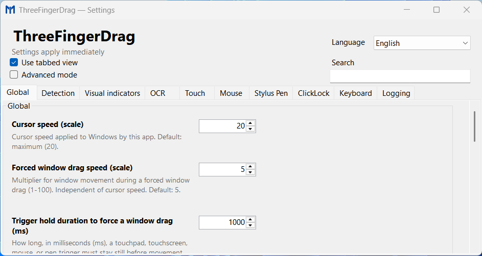

# ThreeFingerDrag

ThreeFingerDrag is a Windows utility for dragging windows and UI elements
with a touchpad, touchscreen, mouse, or stylus.



## English

- [English user guide](docs/en/guide.md)
- [English configuration reference](docs/en/configuration.md)

## Bahasa Indonesia

- [Panduan Bahasa Indonesia](docs/id/panduan.md)
- [Referensi konfigurasi Bahasa Indonesia](docs/id/konfigurasi.md)

## Requirements and installation

- Windows 10 version 1607 (build 14393) or later.
- .NET 8 Desktop Runtime.

Run the setup executable for your CPU (`win-x64`, `win-x86`, or `win-arm64`).
Approve the UAC prompt to install the application and register its elevated
startup task. After choosing the install directory, setup installs immediately
and opens the settings window. Closing it keeps
the program running in the background.

Run the setup executable again to choose reinstall/update or uninstall.
Uninstall removes the current
administrator account's `%LOCALAPPDATA%\ThreeFingerDrag` settings,
translations, and logs. Back up these files first if you want to keep them.

## Build

Requires the .NET 8 SDK. The application always requests administrator
privileges at launch so it can interact with elevated windows.

```powershell
dotnet build src\ThreeFingerDrag.csproj -c Release -p:Platform=x64
```

To publish all supported CPU targets and build setup/uninstall executables into
`publish\`, install Inno Setup 6 and run:

```powershell
.\publish-all.ps1
```

The script produces `publish\installers\ThreeFingerDrag-Setup-win-*.exe`.
The installer creates a Start menu shortcut and registers an elevated
Task Scheduler logon task. Approve UAC during installation. The task runs with
highest privileges at sign-in. Uninstall removes the task and may request
UAC. Starting
`ThreeFingerDrag.exe` directly still prompts for UAC. Windows may show SmartScreen or
Defender warnings for unsigned downloads.

See [LICENSE](LICENSE) and [third-party notices](THIRD-PARTY-NOTICES.md).
